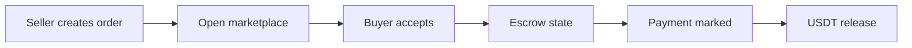

# Telegram P2P USDT Trading Bot

A Telegram-native P2P marketplace prototype for creating, matching, and managing USDT trades with explicit escrow states and blockchain-ledger integration.

> This repository is an engineering prototype. It does not provide custody, compliance, or production financial guarantees. Review the security and regulatory requirements for your jurisdiction before any real-value deployment.

## Core workflow



## Capabilities

- Telegram command and conversation flows powered by Telegraf
- User registration and MongoDB-backed state
- Sell-order creation, discovery, acceptance, and ownership views
- Escrow, fee, and funding ledger accounts
- Balance and escrow-balance checks
- Tatum virtual-account integration
- Operational scripts for seeding and inspecting ledger accounts

## Stack

| Area | Technology |
|---|---|
| Runtime | Node.js |
| Bot framework | Telegraf |
| Data | MongoDB and Mongoose |
| Ledger integration | Tatum API |
| Supporting services | Axios, Moment |

## Getting started

### Prerequisites

- Node.js and npm
- MongoDB
- A Telegram bot token
- Tatum credentials with the required virtual-account access

### Install

```bash
git clone https://github.com/KaranRana21/telegram-p2p-usdt-bot-new.git
cd telegram-p2p-usdt-bot-new
npm install
```

Create a local `.env` file and provide the credentials expected by the application. Never commit tokens, private keys, or production account identifiers.

Seed and inspect the ledger accounts:

```bash
npm run seed
npm run list-escrows
```

Start the bot:

```bash
npm start
```

For the complete verification flow and troubleshooting notes, see [RUN_GUIDE.md](RUN_GUIDE.md).

## Primary commands

| Command | Purpose |
|---|---|
| `/start` | Register and view available actions |
| `/balance` | Inspect the user ledger balance |
| `/escrowbalance` | Inspect escrow state |
| `/sell` | Create a sell order |
| `/orders` | Browse open orders |
| `/myorders` | View the current user’s orders |

## Engineering notes

The project models trading as a stateful workflow rather than a collection of isolated bot commands. Ledger administration is separated into scripts so account setup and operational inspection remain explicit and repeatable.

## Roadmap

- Automated tests for command and state transitions
- Idempotent webhook and transaction handling
- Stronger authorization and audit trails
- Dispute and timeout workflows
- Production observability and alerting
- Compliance, custody, and threat-model review

---

Built by [Karan Rana](https://github.com/KaranRana21).
